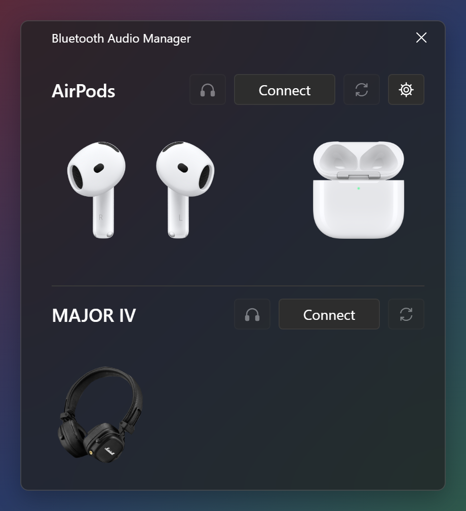
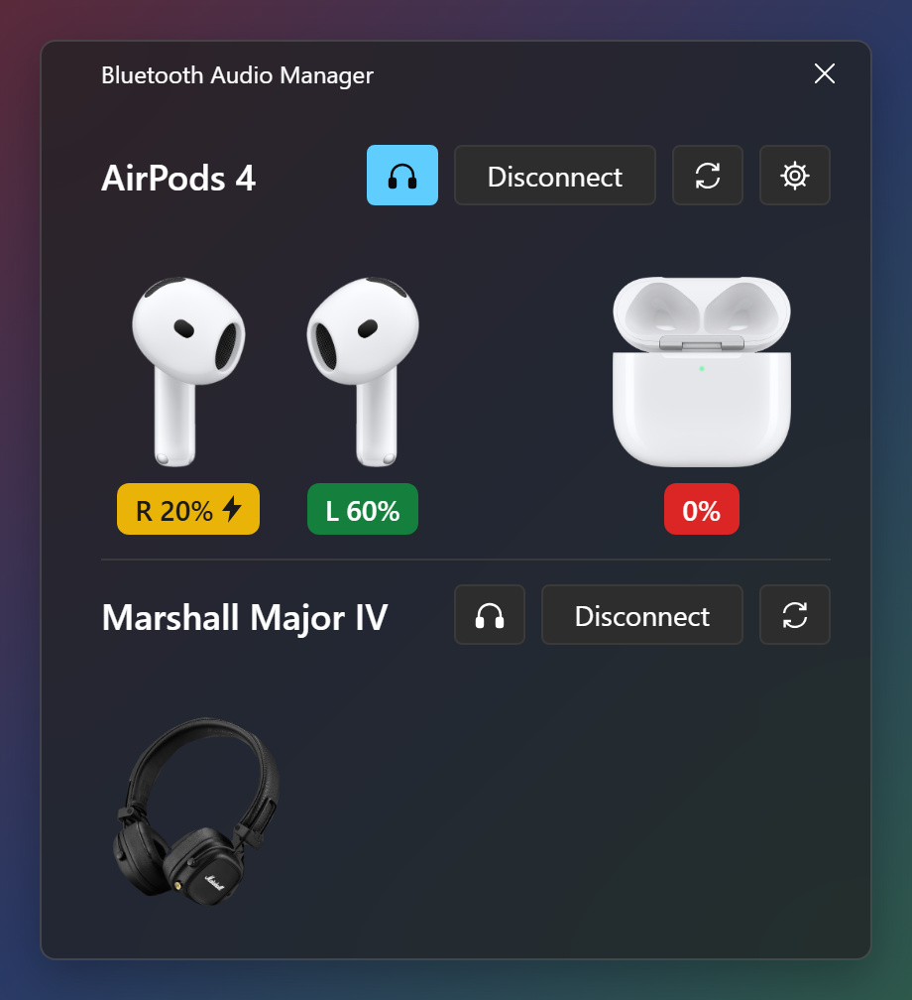
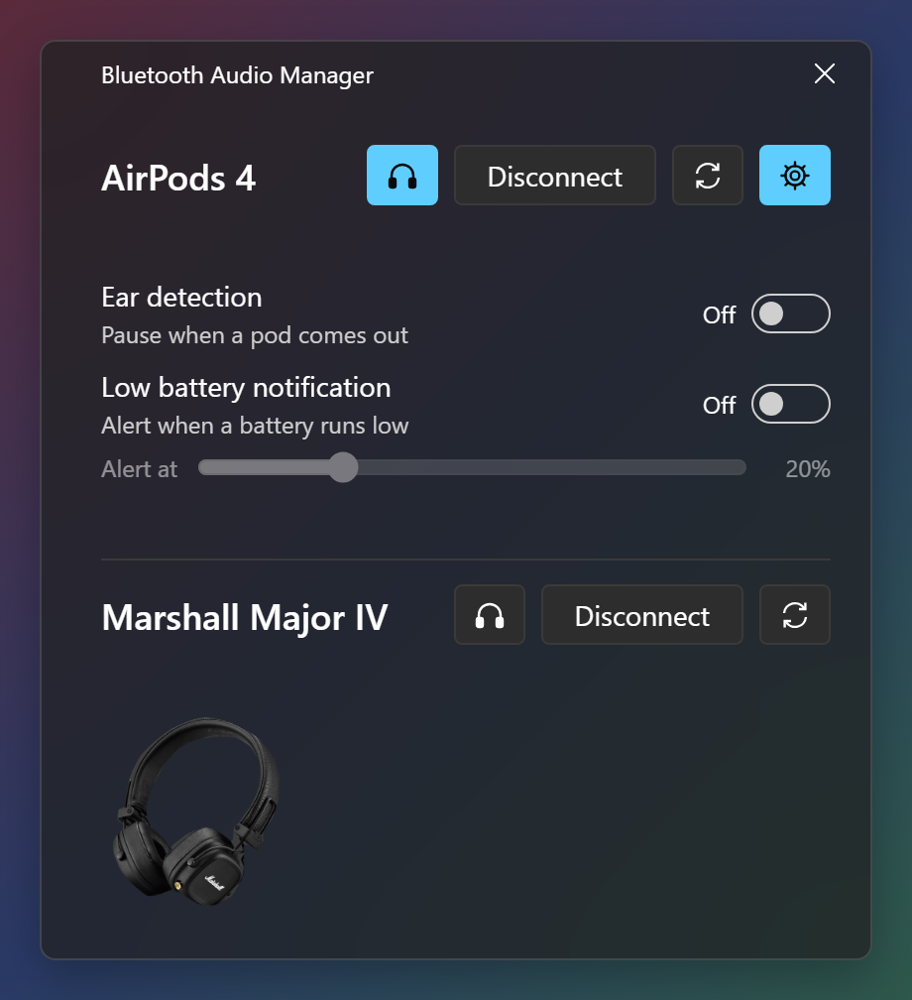
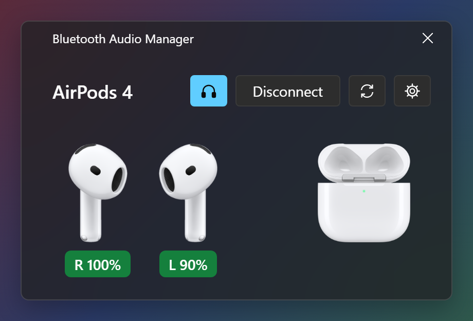
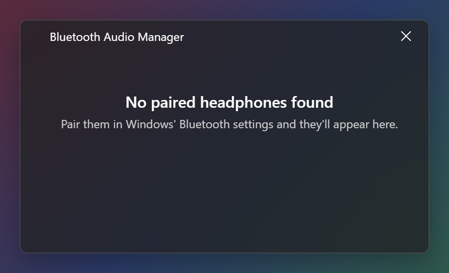

# BluetoothAudioManager

A Windows app that shows the battery of each AirPod and the case, and connects or disconnects your paired Bluetooth headphones.











## How it works

### Battery levels

The app listens for the Bluetooth LE messages AirPods broadcast, so it doesn't need a driver. Apple doesn't document this format, so a firmware update could break it.

- Readings come in 10% steps. The badge is green above 20%, yellow from 10% to 20%, and red below 10%.
- A green bolt next to a badge shows that part is charging. AirPods and Jabra headsets report charging. Windows stores only a level for other headphones, so they never show the bolt.
- The case usually reports only with a pod inside and the lid open.
- A level clears after 1 minute without an update, and all levels clear when the AirPods disconnect. Broadcasts are ignored until they reconnect.
- Broadcasts aren't tied to a paired device, so the app shows the strongest signal nearby. It could show someone else's AirPods if yours aren't broadcasting.
- AirPods Max broadcasts aren't read. AirPods Max appear like other headphones, with their own picture.
- For other headphones, the app reads the level Windows stores, if there is one, using a property Microsoft doesn't document. A device with a level gets a battery badge and a settings button with its own low battery notification. A device without one, like the Marshall Major IV, shows neither.

### Connections

The app lists every paired Bluetooth audio device, connected or not, and checks for changes every 5 seconds. Devices keep their place when they connect or disconnect. To reorder them, hover over a device's name and drag the six-dot handle that appears to its left. Only the handle moves a device. The device lifts off the list and follows the pointer, the others slide aside to show where it will land, and it settles into place when you let go. The order is saved, and a device you unpair keeps its place for when you pair it again. A newly paired device goes last. AirPods are recognized by "AirPods" in their Windows name, so a renamed pair appears as generic headphones with no battery levels. If you've paired more than one set of AirPods, they share one row. AirPods Max are recognized by "AirPods Max" in their name or by their product ID, and get a row of their own. Each row is titled with the device's name in Windows. Every row is the same height, keeping space for a battery badge even on headphones that don't report one. The window shows two devices by default, then scrolls. Drag its top or bottom edge to fit anywhere from one device to all of them, and it remembers that height. With only one device, the window is that device's size.

The connection state comes from Windows' Bluetooth status for those devices.

The Connect button becomes Disconnect while a device is connected, and the Reconnect icon button next to it disconnects the device and connects it again. The settings button only works while the device is connected, and open settings close when it disconnects.

Jabra headsets that connect through a Jabra Link USB adapter aren't paired with Windows, so the app finds the adapter among the sound outputs instead, and lists it while it's plugged in. With Jabra's kit running, the row shows the headset as connected while it's linked to the adapter, and as disconnected when it's off or out of range. If the kit supports the adapter, the row also gets Connect, Disconnect and Reconnect, which ask the adapter to connect the headset last seen on it. Jabra lists this for the Link 380 and Link 390, so other adapters may not get these buttons. Without the kit, the row has only the system output button, and shows as connected whenever the adapter is plugged in. A Jabra Link 370 shows the Jabra Evolve 65 picture, as that's the headset it comes with.

The headset's name, battery level and charging come from Jabra's own kit, which needs a partner key. Jabra gives one free to anyone registered on [developer.jabra.com](https://developer.jabra.com/site/global/docs/partner-key.gsp). Add it to the settings file as `"JabraPartnerKey": "your-key"`, then restart the app. Without a key, or for a headset the kit can't read, the row shows the adapter's name and no battery. Charging from a USB cable makes the headset appear a second time, over USB, so the row uses whichever copy reports a level, and keeps the last level if neither does. With a level, the row also gets a settings button for its low battery notification. These buttons ask the Windows Bluetooth audio driver to make the change, wait up to 15 seconds for each step, and show a failure message if it doesn't happen.

### Ear detection

The AirPods settings have a toggle that pauses media when a pod comes out, off by default. Media resumes when the pods that were in are back, but only if the app paused it and the AirPods are the system output. It reads in-ear status from the same broadcasts as the battery levels, so someone else's AirPods nearby could trigger it. 

### Low battery notification

The AirPods settings also have a toggle and a slider, from 10% to 50%, for a Windows notification when the left pod, right pod or case reaches that level. It's off by default and set to 20%. Each part alerts once, then again only after it has charged back above the level, and a part that's charging doesn't alert.
Settings are saved in `%AppData%\BluetoothAudioManager\settings.json`, and device readings are never saved.

### System output

The headphones button to the left of Connect makes that device the system sound output, using its stereo output if it has one. It's highlighted on the device currently in use. Windows has no public API for this, so the app uses an undocumented interface that an update could change.

### System tray

The app runs from the system tray. Click its icon to show or hide the window above the bottom-right of the taskbar. Clicking elsewhere or pressing the window's X hides it, and the app keeps running. Right-click the icon for **Start with Windows** and **Exit**.

Starting with Windows opens the app hidden in the tray. The setting stores the path of the build you turned it on from, so turn it on again if that build moves.

### Product images

The AirPods pictures in `Assets` come from Apple, `Assets/MajorIV.png` from Marshall, and `Assets/JabraEvolve65.png` and `Assets/JabraEvolve65Mono.png` from Jabra, and those companies own them. The pod and Major IV images are edited cut-outs. They're here for private use only, so remove them before publishing this repo or sharing the app.

The AirPods pictures are chosen by the product ID Windows stores for the paired AirPods. AirPods 3, AirPods 4 and AirPods Pro have their own pictures, and all AirPods Pro use the AirPods Pro 1 pictures. AirPods 1, AirPods 2 and models not recognized yet, such as AirPods 5 and AirPods Pro 3, show the AirPods 4 pictures.

Other headphones get the picture whose entry in `DevicePictures` matches part of their Windows name, such as "MAJOR IV", or a generic headphones placeholder if none does. To add a device, put its picture in `Assets` and add a line to `BluetoothAudioManager.Core/Helpers/DevicePictures.cs`.

## Requirements

- Windows 10 version 2004 or later
- .NET 10 SDK
- A Bluetooth adapter that supports Bluetooth LE

## Run

```bash
dotnet run --project BluetoothAudioManager.App
```

In VS Code, open this folder and press F5. This needs the C# Dev Kit extension, which VS Code recommends when you open the folder.

## Test

```bash
dotnet test
```
